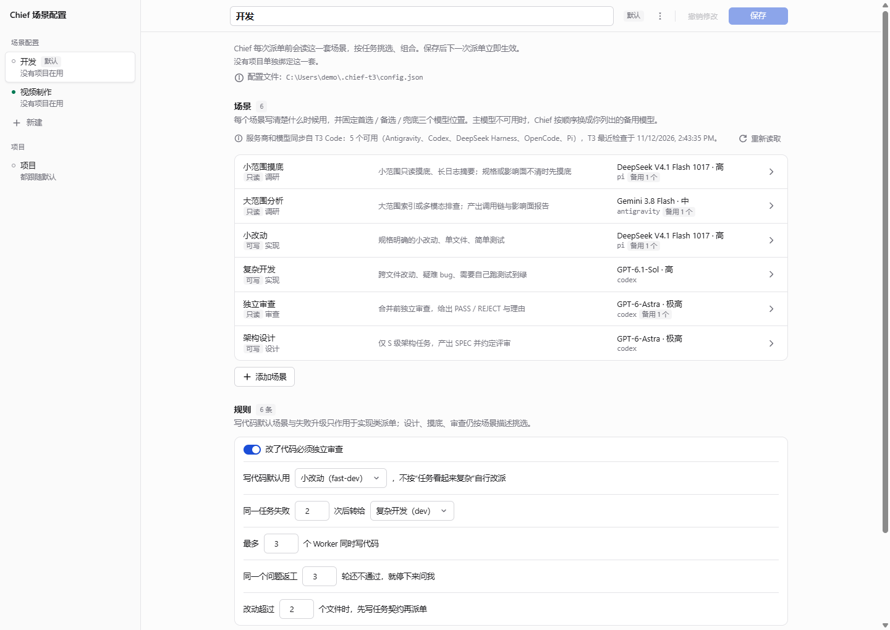

# T3WORKFLOW-CHIEF

> **A Chief (staff-officer) workflow for [T3 Code](https://github.com/earendil-works): decompose → delegate → independent review → accept.**
> 让 T3 Code 的主线程当「幕僚长」：只拆单、写契约、派单、验收，实际干活交给不同模型的子 Agent，并且强制「写代码的模型不能自己验收自己」。

[](#环境要求)
[](#环境要求)
[](https://github.com/earendil-works)
[](LICENSE)

> 非 T3 Code 官方项目，与 T3 Code 作者无隶属关系。

---

## 它解决什么问题

单 Agent 写代码的通病：自己写、自己测、自己说「好了」。T3 Code 有 `delegate_task`，但「派给谁、怎么验收、什么算通过」全靠临场发挥。

这个仓库把那套流程固化下来：

- **一个技能**（`chief-t3`）规定 Chief 怎么拆单、写契约、派单、独立审查、验收；
- **一份配置**（`~/.chief-t3/config.json`）定义有哪些「场景」、每个场景用哪个 provider / 模型 / 推理档位；
- **一个面板**（`panel/`）让你用图形界面改配置，模型选项直接从 T3 Code 同步，不会手写错 ID。

| 组件 | 位置 | 作用 |
|---|---|---|
| 技能 | `skills/chief-t3/SKILL.md` | Chief 的工作流与硬规则（存进 `~/.agents/skills/chief-t3`） |
| 出厂配置 | `skills/chief-t3/workflows/default.json` | 没有全局配置时的默认场景套 |
| 配置 Schema | `skills/chief-t3/workflows/workflow.schema.json` | 编辑器可据此补全校验 |
| 契约模板 | `skills/chief-t3/templates/` | `HANDOFF` / `TASK` / `report` / `review` |
| 配置面板 | `panel/` | 本地网页，零依赖，多套场景 + 项目绑定 |
| 启动器 | `app/` | Windows 桌面快捷方式 / macOS 双击应用 |
| 校验与迁移 | `scripts/` | 配置校验、旧格式迁移 |

## 核心特性

- **场景化选人**：每个场景写清「什么时候用」+ 首选 / 备选 / 兜底三个模型位置；模型不可用时按顺序顺延，用完就报告而不擅自乱换。
- **多套场景配置**：开发、视频制作、写作……各自一套场景与规则，按 T3 项目绑定；没绑定走默认套。
- **强制独立审查**：审查必须是新派的任务，且模型必须与实现模型不同（校验脚本会拦）。
- **契约与台账**：超过阈值文件数才写契约；任务状态只有四种（运行 / 待审 / 等依赖 / 等你），`HANDOFF.md` 保持短小可读。
- **并行派单**：互不依赖的任务一次派完，只在真有依赖处等待；不轮询、不 sleep。
- **可视化配置面板**：服务商 / 模型 / 推理档位都是下拉选择，选项同步自 T3 Code 缓存；改动即时校验，保存前自动备份。

## 快速开始

需要 T3 Code 与本机可用的 provider（例如 Pi、Codex、Antigravity），以及 Bash + Node.js 18+。

```bash
# 1. 取仓库（放哪都行，面板和启动器需要仓库留在磁盘上）
git clone https://github.com/ShawnWei0323/T3WORKFLOW-CHIEF.git
cd T3WORKFLOW-CHIEF

# 2. 安装技能（默认装到 ~/.agents/skills/chief-t3）
bash install.sh

# 3. 给某个 T3 项目装上 Chief 入口（该项目新开线程即进入 Chief 模式）
bash install.sh "/f/your-project"

# 4. 打开配置面板（首次建议先确认场景与模型）
node panel/server.mjs          # http://127.0.0.1:4317
```

然后在 T3 Code 里**新开一个线程**（或 `/reload` 重载技能），直接说需求：

```
把「给首页加个统计卡」拆单派出去
```

Chief 会先读场景配置，报告用的是哪一套，然后按 `label` / `when` 挑场景派单。

> 安装脚本只写目标目录与项目 `AGENTS.md` 的受管区块，不改 T3 配置、不重启 T3、不派单。

## 概念：场景、套、规则

```
~/.chief-t3/config.json
├── defaultSet: "dev"              ← 没绑定项目的 T3 项目用这套
├── projects: { "/f/site": "dev" }  ← 按项目工作区根目录绑定（取最长上级匹配）
└── sets
    ├── dev    { label, scenes, rules }
    └── video  { label, scenes, rules }
```

**场景**（`sets.<套>.scenes.<键>`）：

| 字段 | 说明 |
|---|---|
| `label` / `when` | 显示名 + 什么时候用；Chief 据此挑选、组合 |
| `delegateRole` | 派单顶层的 `role`：`implementation` / `design` / `research` / `review` / `test` / `general` |
| `access` | `write` 或 `readonly`（readonly 不等于技术只读，审查仍保存基线） |
| `reportLimit` | 汇报字数上限，细节写文件 |
| `primary` / `backup` / `fallback` | 首选（必填）/ 备选 / 兜底：`{ provider, model, options }`，`options` 原样进 `target.options` |

**规则**（`sets.<套>.rules`）：

| 字段 | 说明 |
|---|---|
| `requireReview` | 改代码必须独立审查；打开时至少需要一个 `review` 场景 |
| `defaultWriteScene` | 实现类派单默认用哪个场景（不按「看起来更难」自行改派） |
| `escalateTo` / `escalateAfter` | 同一任务失败 N 次后转给哪个实现场景（必须与默认写场景不同） |
| `maxParallelWriters` / `maxReworkRounds` | 并行写 Worker 上限 / 返工轮数上限 |
| `contractFileThreshold` | 改到多少个文件才必须写契约 |

不可配置的硬规则留在 `SKILL.md`：不轮询、审查模型必须与实现模型不同、场景之外不换模型、合并 / 提交 / 推送 / 删除需授权等。

## 配置面板

本地网页，无第三方依赖，只监听 `127.0.0.1`，只编辑全局配置文件。



```bash
node panel/server.mjs                 # 默认 4317，可用 --port 指定
```

Windows 生成桌面快捷方式（PowerShell 5.1+）：

```powershell
powershell -ExecutionPolicy Bypass -File app/build-windows-shortcut.ps1
powershell -ExecutionPolicy Bypass -File app/build-windows-shortcut.ps1 -StartMenu -Port 4318
```

macOS 打包成双击即用的应用：

```bash
bash app/build-mac-app.sh             # 生成 ~/Applications/Chief 工作流.app
```

- **左栏**：多套场景配置（默认带徽标）、新建 / 复制、「项目」入口；手机上为抽屉。
- **场景**：显示名、键名、什么时候用、权限、任务类型、汇报字数，以及首选 / 备选 / 兜底三个模型位。
- **规则**：审查开关、默认写场景、失败升级、并行数、返工轮数、契约阈值。
- **项目**：列出 T3 Code 的项目（只读标题与工作区根目录），下拉选「跟随默认」或指定某一套。
- **高级**：整份文件显示名、配置文件位置、从磁盘重新加载、直接编辑 JSON。
- 服务商 / 模型 / 推理档位**同步自 T3 Code**（只读其缓存中的模型信息，不读账号与密钥）；T3 里新增或启用服务商后点「重新读取」。
- 校验与 `scripts/validate-workflow.mjs` 一致，有问题不能保存；保存前备份为 `*.bak.<时间>`，文件在面板外被改过时拒绝覆盖。
- 位置可用环境变量覆盖：`CHIEF_CONFIG`、`T3CODE_HOME`、`CHIEF_T3_DB`。

## 安装与更新

```bash
bash install.sh                          # 只装 / 更新技能
bash install.sh "/f/project with spaces" # 同时集成项目 AGENTS 与台账
CHIEF_SKILL_DIR="$HOME/.agents/skills/chief-t3" bash install.sh   # 自定义技能目录
```

- 安装前校验参数、源文件、目标路径与既有 `AGENTS.md` 标记结构，**校验失败不写入**。
- 逐文件更新技能，不清空目标目录、不删额外文件；变更前备份到 `.chief-t3-backup.*`。
- 已有 `AGENTS.md` **只替换** `<!-- chief-t3:begin -->` 到 `<!-- chief-t3:end -->` 区块；没有标记则保留原文并追加。
- 相同内容重复安装不改文件、不产生新备份；源目标相同或嵌套、符号链接、路径类型冲突会被拒绝。
- 重装技能不会覆盖你的 `~/.chief-t3/config.json`。

## 仓库结构

```
.
├── AGENTS.md                  # 受管理的项目入口区块（install.sh 写入项目根）
├── skills/chief-t3/
│   ├── SKILL.md               # 技能正文：工具、选场景、契约、审查、收尾
│   ├── workflows/             # 出厂场景配置 + JSON Schema
│   └── templates/             # HANDOFF / TASK / report / review 模板
├── templates/                 # 仓库入口的兼容模板副本
├── panel/                     # 配置面板（index.html + server.mjs）
├── app/                       # 面板启动器：Windows 快捷方式 / macOS 应用
├── scripts/                   # validate-workflow.mjs、migrate-to-scenes.mjs
├── docs/ryugi/specs/          # 场景配置与场景套的设计记录
└── install.sh
```

安装后的技能与模板**自包含**，不再依赖仓库路径；面板与启动器才需要用仓库里的 `panel/`、`scripts/`、`skills/`。

## 常用命令

| 命令 | 作用 |
|---|---|
| `bash install.sh` | 安装 / 更新技能 |
| `bash install.sh <project>` | 集成项目 `AGENTS.md` + 初始化 `~/.t3-tasks/<project>/` |
| `node panel/server.mjs` | 启动配置面板 |
| `node scripts/validate-workflow.mjs <config>` | 校验配置（CLI 与面板共用同一套规则） |
| `node scripts/migrate-to-scenes.mjs <file> [--out x]` | 单份配置转新格式 |
| `node scripts/migrate-to-scenes.mjs --apply` | 整机迁移（以出厂配置为源，已存在先备份） |
| `node scripts/migrate-to-scenes.mjs --apply --from <file>` | 用指定文件作为迁移源（保留你的自定义值） |

## 故障排查

| 现象 | 处理 |
|---|---|
| 新线程没进 Chief 模式 | 项目根要有 `AGENTS.md` 的 chief-t3 区块；全局技能要重载（`/reload` 或新线程） |
| 面板模型下拉是空的 / 标「未启用」 | T3 里启用该服务商后点「重新读取」；读不到缓存时面板退回手动填写 |
| 面板提示「和 T3 当前的服务商 / 模型不一致」 | 出厂默认只用 Codex；本机未启用 Codex 或缺少其中某个模型时会提示，这可能意味着派单跑不起来，并非只是界面提醒。在面板里把该场景的首选 / 备选换成本机实际可用的服务商与模型即可（提示不阻止保存）。 |
| 配置保存被拒 | 面板外文件被改过：先「从磁盘重新加载」；或校验有错，按底部问题列表定位字段 |
| 配置报「旧格式，请先转换」 | `node scripts/migrate-to-scenes.mjs <你的配置> --out 新文件`，核对后再替换 |
| worktree 隔离派单失败 | 项目必须是 git 仓库；父线程未提交改动不会复制进 worktree |
| 升级后行为没变 | 技能在会话启动时加载，重开线程才会读到新规则 |

## 开发和验证

```bash
bash -n install.sh
node scripts/validate-workflow.mjs skills/chief-t3/workflows/default.json
node scripts/validate-workflow.mjs ~/.chief-t3/config.json
```

安装回归建议在临时 `HOME` 与 `CHIEF_SKILL_DIR` 下跑，覆盖：已有文件与备份、无效参数零写入、带空格路径、源目标冲突、模板自包含、重复安装、`AGENTS.md` 用户内容保留。不需要真实派单或浏览器。

## 贡献

- 提 Issue 说清复现步骤、T3 Code 版本、provider 与模型 ID。
- PR 请只改仓库内文件：**不要提交 `~/.chief-t3/config.json` 或 `~/.t3-tasks/` 下的个人数据**，也不要提交模型 ID 的私人偏好到 `workflows/default.json`（除非是通用出厂值）。
- 改动 `SKILL.md` 的硬规则时，同步更新 `AGENTS.md` 与 README 的对应描述。

## License

[MIT](LICENSE)

---

### English

T3WORKFLOW-CHIEF turns a T3 Code main thread into a **Chief**: it decomposes a request, writes a small contract, delegates to scene-defined child agents (provider + model + reasoning level), requires an **independent review with a different model**, and reports results with explicit status. Scene sets and their rules live in one JSON config (`~/.chief-t3/config.json`), editable through a dependency-free local panel that syncs model choices from T3 Code. Requires T3 Code, a working provider, Bash and Node.js 18+.

```bash
git clone https://github.com/ShawnWei0323/T3WORKFLOW-CHIEF.git && cd T3WORKFLOW-CHIEF
bash install.sh && bash install.sh "/path/to/t3-project"
node panel/server.mjs
```
